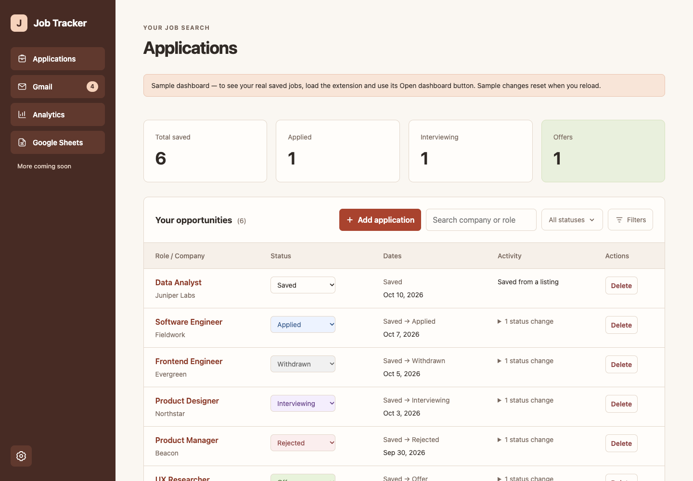
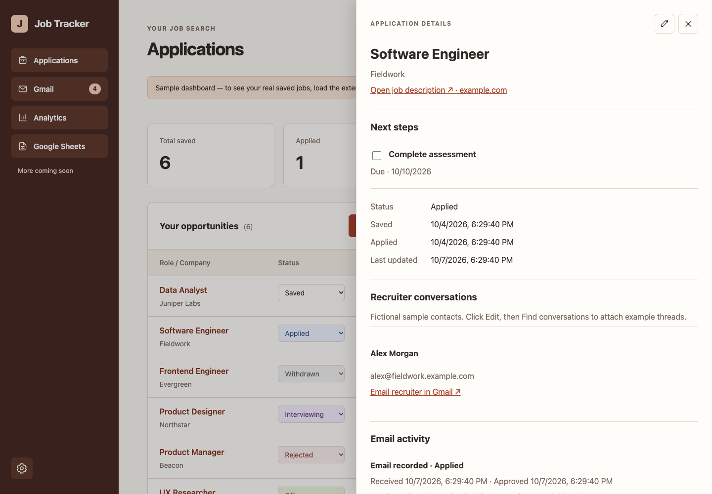
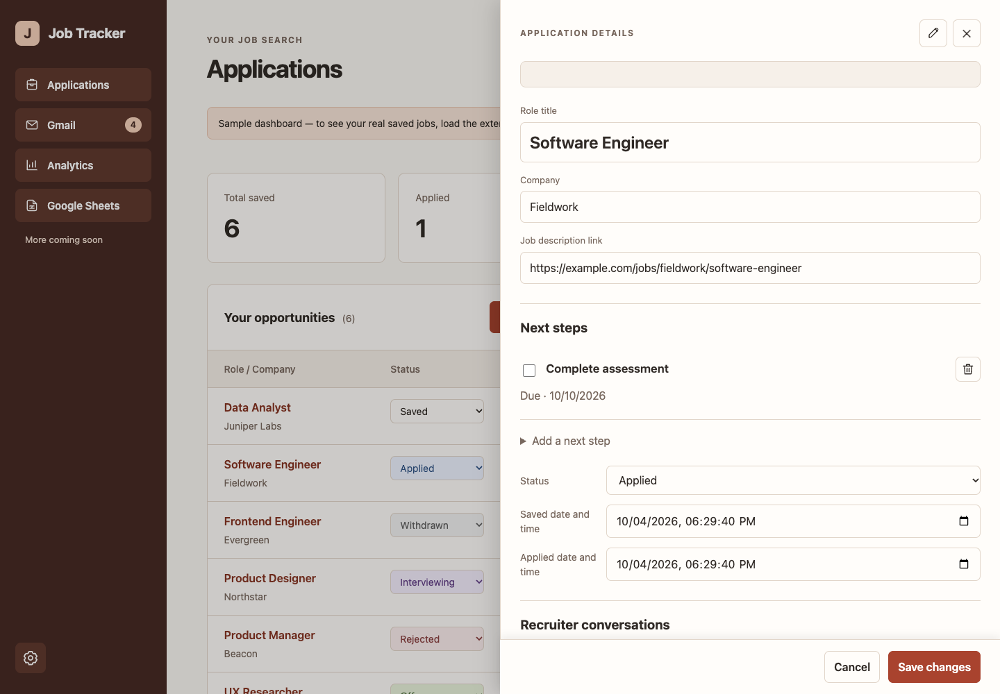
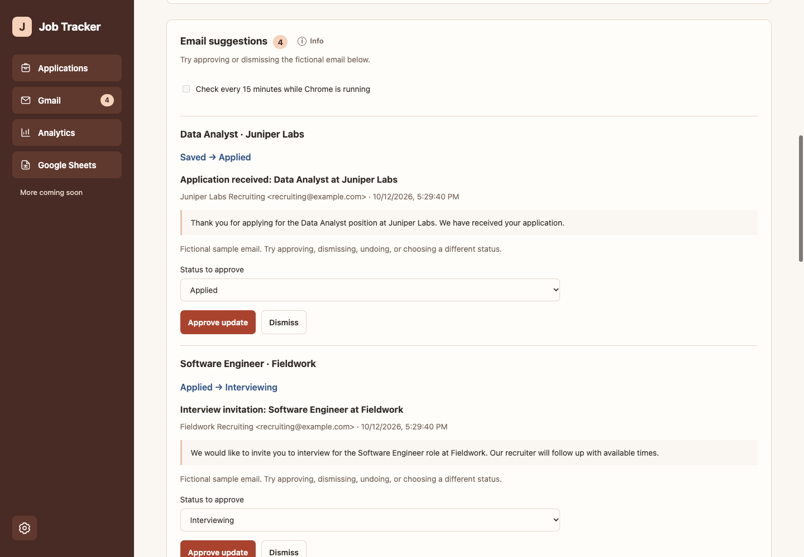
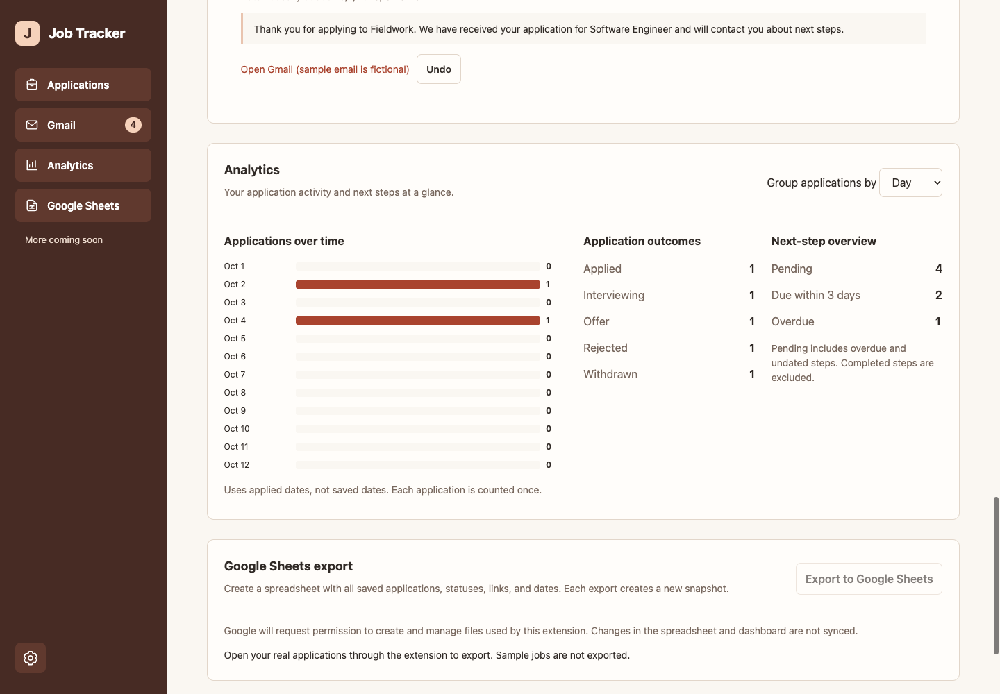

# Job Application Tracker: Quick start

Already installed? Here’s how to use it.

## Contents

- [Save a job](#1-save-a-job)
- [Open your dashboard](#2-open-your-dashboard)
- [Track your progress](#3-track-your-progress)
- [Review email updates](#4-review-email-updates-optional)
- [Find what needs attention](#5-find-what-needs-attention)
- [Keep a copy](#keep-a-copy)
- [Screenshots and explanations](#see-it-in-action)

## 1. Save a job

Open a job listing in Chrome. Click the puzzle-piece icon beside the address bar, then **Job Application Tracker**.

Give the menu a moment to open. Check the role, company and job link, then click **Save job**. You can correct any details before saving.

Saving a job adds it to your tracker—it does not submit an application.

## 2. Open your dashboard

Click **Open dashboard** in the extension menu. Bookmark the dashboard for easy access: **Command+D** on Mac or **Ctrl+D** on Windows.

## 3. Track your progress

After you apply on the employer’s website, change the job’s status to **Applied**. Update it again when you get an interview, offer or other result.

Click a role to open its details. Click the pencil icon to edit its notes, dates or next steps, then click **Save changes**.

**Example:** Save a Software Engineer listing → apply on the employer’s website → set it to Applied → add “Prepare for interview” as a next step.

## 4. Review email updates (optional)

Connect Gmail using the account approved for testing. Click **Check now** to look for job-related emails.

For each suggestion, check the selected job and status. Change either if needed, then click **Approve**. Click **Dismiss** if it isn’t relevant. Use the trash icon to remove an unwanted suggested next step before approving.

If an email is missing, open its job → pencil icon → **Add email manually**. Search by subject, select the correct email, choose its status and click **Save changes**. Click a selected email again to unselect it.

## 5. Find what needs attention

Use search or **Filters** to find jobs. Click the Role, Company, Status or Dates headings to sort; click three times to return to the default order.

Turn on **Next-step reminders** in Settings to highlight pending tasks. **Pending steps first** then becomes available in Filters.

## Keep a copy

Download a **JSON backup** from the dashboard to preserve your jobs and settings. Google Sheets export creates a separate spreadsheet snapshot.

Need help or found a bug? Email **kylechenapps@gmail.com**.

## See it in action

These are actual browser captures of the extension’s sample dashboard, using fictional jobs and emails. Gmail search requires a connected account and is not demonstrated here.

### Your dashboard

Each row is a job. Change its status as you make progress, search for a role or company, or use Filters to narrow the list. Click the role to see its details.

### Job details

See the job’s next steps, dates, recruiter conversations and email history together. Use the pencil icon to edit the job.

### Edit a job

Edit the role or company and scroll down for notes, dates and email activity. Click Save changes when finished; Cancel discards pending edits.

### Review an email

The first sample suggests changing Juniper Labs from Saved to Applied. The dropdown starts at Applied: approve it if correct, choose another status, or dismiss the email.

### Check your progress

Analytics shows applications over time, current outcomes and unfinished next steps. Choose Day, Week or Month to change the chart grouping.
